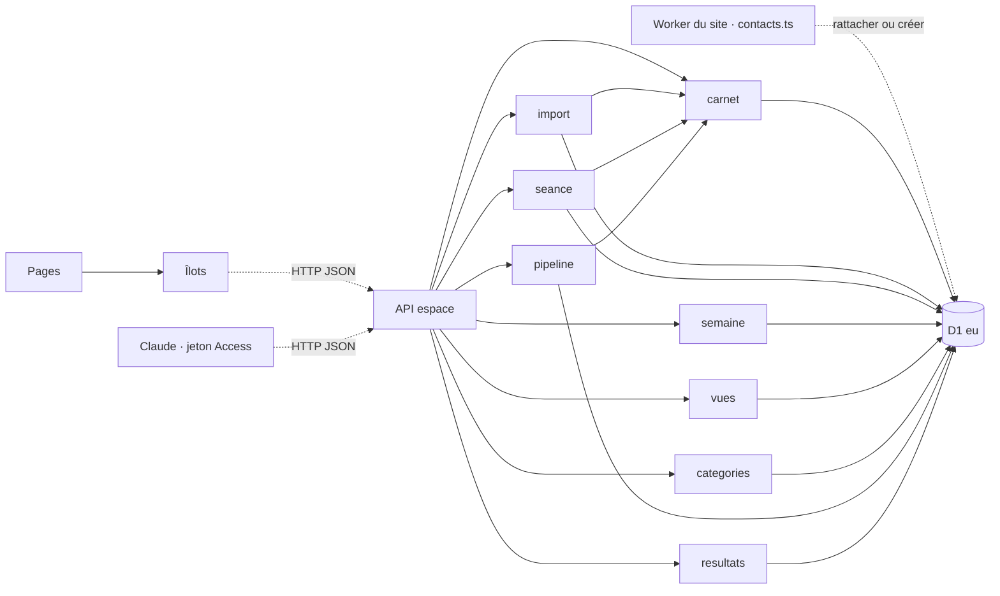
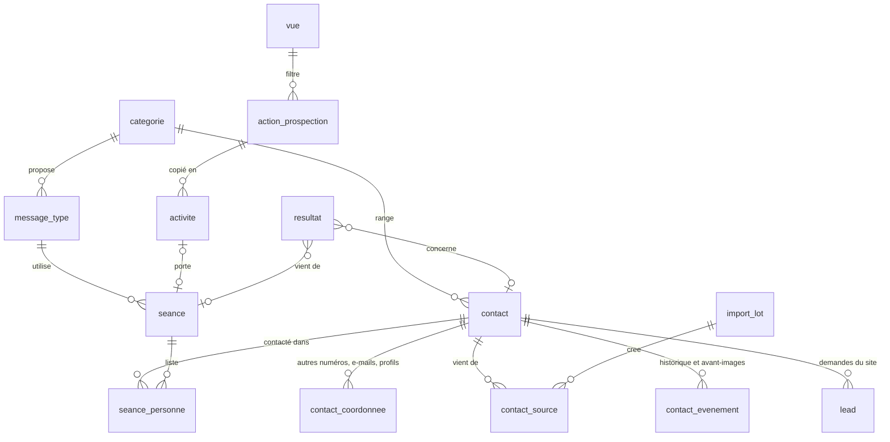

# Architecture Spine — Espace d'Anne, contacts et prospection

## Design Paradigm

**Carnet unique côté serveur.** Toute personne qu'Anne connaît est une ligne de `contact`, qu'elle vienne du site, d'un import ou d'une saisie, qu'elle soit ou non dans le suivi des ventes (le pipeline). Chaque colonne a **un seul module écrivain**, nommé dans AD-22. Les pages sont rendues par le serveur de l'espace ; le JavaScript du navigateur vit dans un îlot par page (tableau des contacts, séance, semaine) et ne parle au serveur que par `espace/src/pages/api/`.

| Couche | Répertoire | Ce qui y vit | Ne dépend jamais de |
| --- | --- | --- | --- |
| Pages | `espace/src/pages/` | Contacts, Séances, Semaine, Bilan, Catégories ; pages existantes inchangées, reliées par le menu « Autres outils » | La base directement |
| Îlots | `espace/src/islands/` | Tableau filtrable, déroulé de séance, grille de la semaine | La base, les secrets |
| API | `espace/src/pages/api/` | Routes JSON, vérification Access, validation | Rendu |
| Modules écrivains | `espace/src/server/` | `carnet`, `categories`, `import`, `vues`, `seance`, `semaine`, `resultats` ; existants : `pipeline`, `accord`, `actions`, `leedflow`, `campagnes`, `tableur` | Pages, îlots |
| Base | `site/migrations/` | Schéma versionné, partagé avec le site (AD-19) | — |

## Inherited Invariants

| Inherited | From parent | Binds here |
| --- | --- | --- |
| AD-4 | spine du site | Écrire d'abord : une coche, un import, une fusion sont enregistrés avant tout effet secondaire. |
| AD-8 | spine du site | Aucun nouveau fournisseur ; l'e-mail groupé futur (FR-17) passe par l'adaptateur Resend existant. |
| AD-9 | spine du site | Claude ne manipule aucun mot de passe ; son accès passe par le jeton de service Access de l'espace. |
| AD-16 | spine du site | Purge à 3 ans sur `last_activity_at` ; données en D1 `eu`. S'applique aux contacts importés. |
| AD-18 | spine du site | Export et effacement couvrent les nouvelles tables ; la recherche par téléphone ou identifiant (story 13.23) sert aux contacts sans e-mail. |
| AD-19 | spine du site | L'espace reste un Worker séparé sur la même base ; migrations dans `site/migrations/`, essayées contre les deux applications. |
| AD-20 | spine du site | Une personne = un contact ; le site ne fait que rattacher ou créer. Amendé par AD-22 : la règle « prochaine action datée » ne vaut que dans le pipeline. |
| AD-21 | spine du site | L'accord e-mail reste sur `contact` (`email_accord_*`), écrit par `accord` ; FR-10 l'alimente sans nouvelle colonne. |

## Invariants & Rules



### AD-22 — Un seul carnet ; chaque colonne de `contact` a son écrivain

- **Binds:** FR-1 à FR-11, FR-15, FR-16, AD-20
- **Prevents:** la même personne en deux exemplaires ; deux modules qui écrivent la même colonne ; 800 contacts importés refusés par la règle « prochaine action datée »
- **Rule:** La table `contact` porte tous les contacts. `etape` et `canal` (origine) deviennent facultatifs ; `etape` NULL = contact du carnet, hors pipeline ; la règle d'AD-20 ne s'applique qu'aux contacts dont `etape` n'est pas NULL. Répartition des écritures :

| Colonnes | Seul écrivain |
| --- | --- |
| `prenom`, `nom`, `telephone`, `email`, `commune`, `entreprise`, `categorie_id`, `projet`, `temperature`, `verifie_le`, `ecarte_le`, `dernier_contact_le`, `dernier_contact_canal`, `last_activity_at` | `espace/src/server/carnet` (appelé par `import`, `seance`, `pipeline` et les routes du tableau) |
| `etape`, `parcours`, `prochaine_action*`, `reveil_le`, `motif_perte`, `qualification*`, `bien_ref`, `passage_id`, `prescripteur_id` | `espace/src/server/pipeline` (existant) |
| `email_accord_*`, `email_desinscrit_le` | `espace/src/server/accord` (existant) |
| `action_id` | déclencheur `contact_action_auto` et `actions` (existants) |
| `synthese*` | `leedflow` (existant) |
| création d'un contact et `canal`, `origine_detail` à la création | `site/src/server/contacts.ts` (rattachement) et `carnet` |

Toute écriture d'un module met à jour `last_activity_at`. Entrée dans le pipeline : quand Anne y passe un contact, ou quand une demande du site ou d'un portail arrive sur un contact dont `etape` est NULL (`etape` = `a_qualifier`) ; `parcours` est alors pris du projet s'il vaut `vendeur` ou `acheteur`. Un contact importé n'entre jamais seul dans le pipeline.

### AD-23 — La migration 0018 reconstruit `contact` sans rien perdre

- **Binds:** AD-22, AD-19, toutes les tables qui référencent `contact`
- **Prevents:** un `DROP TABLE contact` qui efface en cascade l'historique, les tâches Leedflow et les destinataires de campagne, et détache les demandes du site
- **Rule:** Dans D1, différer les clés étrangères n'empêche pas les `ON DELETE CASCADE`. La migration suit donc cet ordre, dans une seule exécution : copier dans des tables temporaires `contact_evenement`, `leedflow_tache`, `leedflow_lien`, `campagne_destinataire` et les couples `lead.id`/`contact_id` ; créer `contact_nouveau` avec toutes les colonnes de 0007, 0010, 0012, 0013 plus celles d'AD-22, AD-24 ; copier les lignes ; supprimer `contact` ; renommer ; recréer les six index, l'unicité partielle téléphone et e-mail, et le déclencheur `contact_action_auto` ; reconstruire `contact_evenement` avec les types et sources élargis (types `import`, `fusion`, `seance`, `classement` ; source `claude`) ; restaurer les tables enfants et `lead.contact_id` ; supprimer les tables temporaires. Reprise : `projet` = `parcours` quand il existe, sinon `a_qualifier`. Avant la production : exécution sur la base d'aperçu avec comptage de chaque table avant et après, chiffres cités dans la story.

### AD-24 — Projet et température : valeurs fermées, cohérence tenue par la base

- **Binds:** FR-1, FR-2, FR-4, FR-15, AD-22
- **Prevents:** une température sur un ambassadeur ; « déjà en vente » sur un acheteur ; une température qui contredit l'étape du pipeline
- **Rule:** `projet` ∈ {`a_qualifier`, `vendeur`, `acheteur`, `vendeur_acheteur`, `ambassadeur`}, `a_qualifier` par défaut. `temperature` ∈ {`froid`, `tiede`, `chaud`, `en_vente`, `recherche_active`, `avec_anne`, `termine`} ou NULL. Contraintes `CHECK` : NULL si le projet est `a_qualifier` ou `ambassadeur` ; `en_vente` seulement pour `vendeur` et `vendeur_acheteur` ; `recherche_active` seulement pour `acheteur`. Changer le projet vers une valeur incompatible remet la température à NULL dans la même écriture. Lien avec le pipeline, écrit par `pipeline` via `carnet` : entrer dans le pipeline (étape autre que `perdu`, `en_sommeil`) pose `avec_anne` ; `vendu` ou `acte_signe` pose `termine`. Hors pipeline, Anne ne peut pas choisir `avec_anne` ni `termine`.

### AD-25 — Catégories et messages types sont des données

- **Binds:** FR-9, FR-12, FR-13, FR-15, FR-16
- **Prevents:** une catégorie renommée qui casse des contacts ou des vues ; une règle d'appel codée en dur ; deux définitions d'« ancien client »
- **Rule:** Tables `categorie` (`id`, `nom`, `ordre`, `canal_conseille`, `demande`, `appel_permis`, `envoi_groupe_permis`) et `message_type` (`id`, `categorie_id`, `nom`, `texte` avec `{prénom}`). Les cinq catégories de départ ont des identifiants fixes, créés par la migration : `anciens_clients`, `proches`, `edb`, `partenaires`, `lointains` ; les suivantes reçoivent un ULID. Les vues et le pré-rangement citent l'`id`, jamais le nom. Une catégorie ne se supprime que vide. « Ancien client » a une seule définition, dans `accord` : `categorie_id = 'anciens_clients'` ou `etape IN ('vendu', 'acte_signe')`. Seul `categories` écrit ces tables.

### AD-26 — Un import est un lot, passé par un seul module, et s'annule

- **Binds:** FR-7 à FR-11, question 4 du PRD
- **Prevents:** un mauvais fichier qui salit tout le tableau sans retour ; deux chemins d'import qui dédoublonnent différemment ; une fusion invisible
- **Rule:** Tout import passe par `espace/src/server/import`, appelé par la route `api/import`, depuis l'écran de l'espace ou par Claude avec le jeton de service Access ; jamais de SQL direct. L'ancien import de `pipeline` et sa page sont retirés quand ce module est en ligne. Deux temps : aperçu sans écriture (nouveaux, compléments, doublons probables, rejetés), puis `import_lot` (`id`, `fichier`, `source`, `a`, `par`, compteurs). Formats : vCard 2.1, 3.0 et 4.0 avec décodage quoted-printable, CSV et `.xlsx` (module `tableur`). Les numéros passent en E.164 avant toute comparaison. Doublon sûr : même téléphone, même e-mail ou même lien de profil, cherchés dans `contact` et `contact_coordonnee`. Le premier téléphone et le premier e-mail vont sur `contact`, les autres dans `contact_coordonnee` (`contact_id`, `type` ∈ {`telephone`, `email`, `profil`}, `reseau`, `valeur` unique). Chaque contact touché reçoit une ligne `contact_source` (`contact_id`, `source`, `import_lot_id`) et un `contact_evenement` qui garde l'avant-image (AD-29). Pré-rangement selon FR-9, sans jamais changer une catégorie vérifiée. Annuler un lot rejoue les avant-images des contacts qu'il a touchés et supprime ceux qu'il a créés, sauf ceux modifiés depuis par Anne, JB ou une séance (AD-29), qui restent et sont listés. **Décision de JB (01/11, 20 h 55) : le premier import, les 882 contacts du téléphone d'Anne, est fait par Claude.** Le jeton de service Access de Claude reçoit l'accès à `api/import` seulement (aperçu, import, annulation d'un lot) : jamais la lecture du tableau ni des fiches. Le réglage est décrit au RUNBOOK § 4 sexies au moment de la livraison. L'écran d'import de l'espace vient après.

### AD-27 — Une vue enregistrée est un filtre, dans un vocabulaire fermé

- **Binds:** FR-2, FR-15, FR-19
- **Prevents:** une vue qui ne retrouve plus ses contacts ; un filtre compris différemment par le navigateur et par le serveur
- **Rule:** Table `vue` (`id`, `nom`, `ordre`, `filtre` JSON). Clés permises, définies une fois dans `espace/src/server/vues` et importées par l'îlot : `categorie_id`, `projet`, `temperature`, `source`, `entreprise_contient`, `ville`, `verifie` (oui, non), `ecarte` (oui, non ; non par défaut), `accord`, `dernier_contact` (`jamais` ou nombre de jours), `pipeline` (dans, hors), `recherche`. Une clé inconnue est refusée. Le tableau charge tous les contacts non effacés, y compris ceux du pipeline, et filtre dans le navigateur. Une vue se crée, se renomme et se supprime librement (sauf « Tous les contacts », qui n'est pas en base). Une action de prospection (AD-30) ne cite pas la vue : elle en copie le filtre et le nom au moment où on la choisit, pour que supprimer une vue ne casse aucune action.

### AD-28 — La coche « contacté » s'écrit à un seul endroit

- **Binds:** FR-15, FR-16, FR-21, FR-22, FR-25
- **Prevents:** un dernier contact qui ne correspond à aucune séance ; une barre d'effort qui ne compte pas comme le tableau
- **Rule:** Tables `seance` (`id`, `nom`, `message_type_id`, `commentaire`, `activite_id` facultatif, `ouverte_le`, `terminee_le`) et `seance_personne` (`seance_id`, `contact_id` avec `ON DELETE CASCADE`, `ordre`, `canal`, `contacte_le`, `note`). Cocher fait, dans un seul lot d'écritures de `seance` : `seance_personne.contacte_le` et `canal`, puis par `carnet` `dernier_contact_le`, `dernier_contact_canal`, `last_activity_at` et un `contact_evenement` avec l'avant-image. Décocher rejoue cette avant-image. Aucun autre module n'écrit `dernier_contact_*`. La quantité réalisée d'une activité de séance est calculée à partir des coches, jamais saisie.

### AD-29 — Toute écriture du carnet garde son avant-image

- **Binds:** FR-4, AD-26, AD-28
- **Prevents:** des annulations promises mais impossibles faute de valeurs d'avant ; « modifié à la main » compris différemment par deux modules
- **Rule:** Chaque écriture de `carnet` ajoute un `contact_evenement` dont `donnees` vaut `{ "avant": {colonne: valeur}, "apres": {colonne: valeur}, "lot": id }`. Annuler = réécrire `avant` par `carnet`. Un contact est « modifié depuis un lot » s'il porte un événement postérieur au lot dont la source n'est pas ce lot. L'annulation d'une action groupée (FR-4) vaut tant qu'aucune autre écriture n'a touché ces contacts. Les jours (« même jour », semaine, bilan) se comptent en heure de Paris.

### AD-30 — Un modèle d'action se copie ; une activité posée ne bouge plus avec lui

- **Binds:** FR-18 à FR-23
- **Prevents:** une semaine passée réécrite parce qu'un modèle a changé ; une confusion avec le bilan des pubs
- **Rule:** Tables `action_prospection` (modèle : `id`, `nom`, `type`, `duree_h` 1 à 3, `filtre` JSON copié d'une vue et `vue_nom`, `message_type_id`, `script`, `ordre`) et `activite` (`id`, `action_id` facultatif, `nom`, `type`, `jour`, `heure_debut` 8 à 18, `duree_h` 1 à 3, `vise`, `fait`, `note`, `secteur` texte libre, rempli pour un boîtage ; une zone dessinée sur carte viendra plus tard dans une colonne à part, sans toucher à celle-ci), avec `heure_debut + duree_h` ≤ 19. `type` ∈ {`seance`, `boitage`, `rencontre`, `autre`}. Poser une action copie son nom, son type et sa durée. Supprimer ou modifier un modèle ne touche aucune activité. Seul `semaine` écrit ces tables. La table `action_marketing` (bilan des pubs) reste distincte et intacte.

### AD-31 — Écarter n'est pas effacer ; purge et effacement couvrent tout

- **Binds:** FR-5, AD-16, AD-18
- **Prevents:** un contact écarté qui disparaît sans trace ; une purge qui échoue en entier à cause d'une nouvelle table ; une personne appelée hier purgée
- **Rule:** Écarter pose `ecarte_le` ; le contact sort des vues (sauf filtre `ecarte`) et des séances futures. Toute nouvelle table qui référence `contact` le fait avec `ON DELETE CASCADE`. La story de la migration 0018 met à jour `site/src/server/purge.ts` et `site/src/server/rights.ts` pour `contact_source`, `contact_coordonnee` et `seance_personne`. Un contact importé relève de l'intérêt légitime, comme un contact saisi par Anne (AD-20), sous réserve de la question 5 du PRD.

### AD-32 — Leedflow ne s'attache qu'aux contacts du pipeline

- **Binds:** AD-20 (entrée 4), AD-22
- **Prevents:** les appels personnels d'Anne rattachés à ses amis parce que leurs numéros viennent d'être importés
- **Rule:** La relève Leedflow ne rattache un appel qu'à un contact dont `etape` n'est pas NULL ; un numéro qui n'existe que dans le carnet reste « inconnu » et proposé comme aujourd'hui.

### AD-33 — Un résultat est noté à la main et rattaché si on le connaît

- **Binds:** FR-24, FR-25
- **Prevents:** un résultat compté deux fois ; un bilan qui ne sait pas à quoi attribuer un rendez-vous
- **Rule:** Table `resultat` (`id`, `type` ∈ {`rdv`, `recommandation`, `mandat`}, `le`, `contact_id` facultatif avec `ON DELETE SET NULL`, `seance_id` facultatif, `activite_id` facultatif, `note`). Seul `resultats` l'écrit. Le bilan compte un résultat sous le type de son activité, ou « séance » s'il est rattaché à une séance.

## Consistency Conventions

| Concern | Convention |
| --- | --- |
| Nommage | Tables et colonnes en `snake_case` français ; valeurs fermées en minuscules ASCII ; libellés accentués seulement à l'affichage |
| Vocabulaires fermés | Canal de contact (`seance_personne.canal`, `dernier_contact_canal`) ∈ {`whatsapp`, `sms`, `email`, `appel`, `message_prive`}, distinct de `contact.canal` (origine) ; source d'import (`contact_source.source`) ∈ {`telephone`, `linkedin`, `edb`, `reseaux`, `tableur`, `saisie`, `site`} |
| Données & formats | Identifiants ULID (sauf catégories de départ, AD-25) ; dates ISO 8601 UTC, jours `AAAA-MM-JJ` en heure de Paris ; téléphones E.164 ; e-mails en minuscules ; réponses `{ ok, ... }` ou `{ ok: false, error: { code, message } }` |
| État & transversal | L'écrivain de chaque colonne est celui d'AD-22 ; toute route `api/` vérifie le jeton Access côté serveur ; journaux sans donnée personnelle |
| Routes | `/contacts` devient le nouveau tableau ; `/contacts/[id]` (fiche) reste ; les autres pages existantes gardent leur adresse et ne sont plus reliées que par « Autres outils » ; nouvelles pages `/seances`, `/semaine`, `/categories` ; `/bilan` est remplacé |
| Migrations | Numérotées à partir de `0018-` dans `site/migrations/` ; essayées sur la base d'aperçu avec comptages avant et après |

## Stack

| Name | Version |
| --- | --- |
| Astro | 7.4 (existant) |
| @astrojs/cloudflare | 14.4 (existant) |
| Wrangler | 4.151 (existant) |
| TypeScript | 6.0 (existant) |
| Cloudflare D1 | bases `anne-leads` (production) et `anne-leads-apercu` (aperçu) |

## Structural Seed



```text
espace/src/
  islands/        # tableau-contacts, seance, semaine
  pages/          # contacts, seances, semaine, bilan, categories ; pages existantes inchangées
  pages/api/      # contacts, import, vues, seances, semaine, categories, resultats
  server/         # carnet, categories, import (+ vcard), vues, seance, semaine, resultats ; existants
site/migrations/  # 0018 et suivantes
site/src/server/  # purge.ts, rights.ts mis à jour (AD-31)
```

Environnements inchangés (AD-19) : la branche de travail est construite sur l'aperçu de l'espace avec la base d'aperçu ; `main` est construite en production.

## Capability → Architecture Map

| Capability / Area | Lives in | Governed by |
| --- | --- | --- |
| FR-1 à FR-6, tableau et classement | `islands/tableau-contacts`, `server/carnet` | AD-22, AD-24, AD-27, AD-29, AD-31 |
| FR-7 à FR-11, import | `server/import`, `api/import` | AD-26, AD-23, AD-20, AD-21 |
| FR-12, FR-13, catégories | `server/categories` | AD-25 |
| FR-14, navigation | `pages/` | Conventions « Routes » |
| FR-15 à FR-17, séance | `islands/seance`, `server/seance` | AD-28, AD-25, AD-8 |
| FR-18 à FR-22, semaine | `islands/semaine`, `server/semaine` | AD-30, AD-28 |
| FR-23 à FR-25, bilan et résultats | `pages/bilan`, `server/resultats` | AD-33, AD-28, AD-30 |

## Deferred

- **Cadre légal des contacts du téléphone** (question 5 du PRD) : à vérifier avant le premier import réel.
- **E-mail groupé depuis une séance (FR-17)** : reprend AD-21 le moment venu.
- **Travail à plusieurs en même temps** : la dernière écriture l'emporte (hypothèse FR-6) ; pas de verrou.
- **Glisser-déposer et poignée de durée** : HTML natif sans bibliothèque, à revoir seulement si le navigateur d'Anne pose problème.
