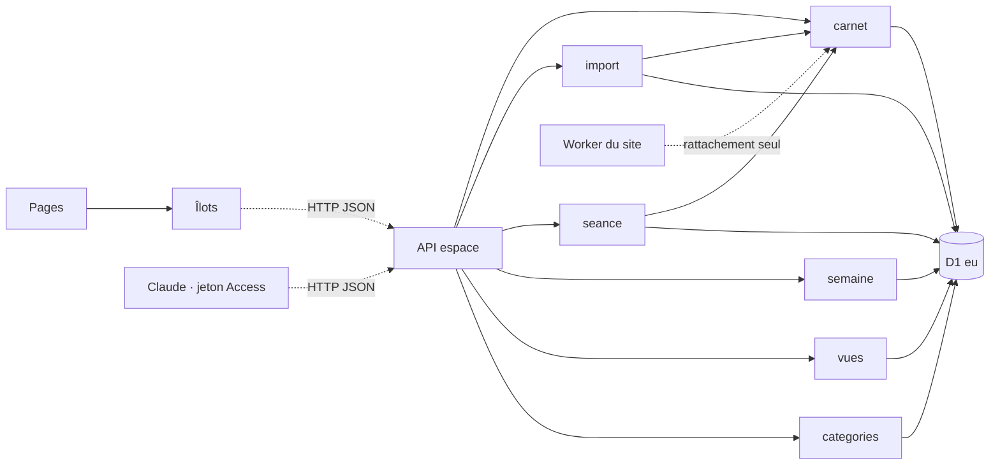
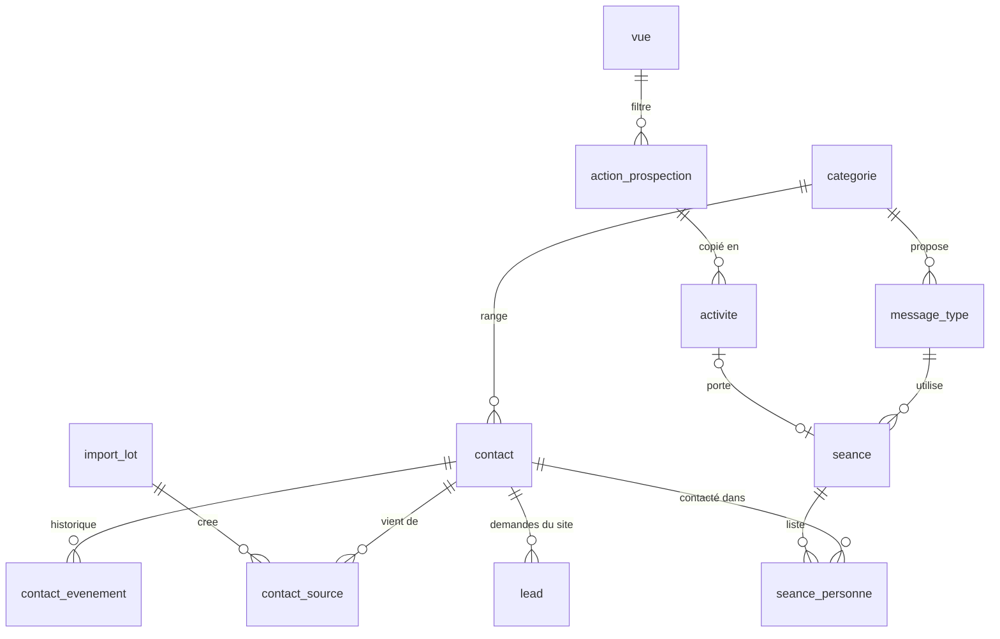

# Architecture Spine — Espace d'Anne, contacts et prospection

## Design Paradigm

**Carnet unique côté serveur.** Toute personne qu'Anne connaît est une ligne de `contact`, qu'elle vienne du site, d'un import ou d'une saisie. Chaque table a **un seul module écrivain** dans `espace/src/server/`. Les pages sont rendues par le serveur de l'espace ; le JavaScript du navigateur vit dans un îlot par page (tableau des contacts, séance, semaine) et ne parle au serveur que par les routes `espace/src/pages/api/`.

| Couche | Répertoire | Ce qui y vit | Ne dépend jamais de |
| --- | --- | --- | --- |
| Pages | `espace/src/pages/` | Contacts, Séances, Semaine, Bilan, Catégories ; « Autres outils » pour les pages actuelles | La base directement |
| Îlots | `espace/src/islands/` | Tableau filtrable, déroulé de séance, grille de la semaine | La base, les secrets |
| API | `espace/src/pages/api/` | Routes JSON, vérification Access, validation des entrées | Rendu |
| Modules écrivains | `espace/src/server/` | `carnet`, `categories`, `import`, `vues`, `seance`, `semaine`, `pipeline` (existant) | Pages, îlots |
| Base | `site/migrations/` | Schéma versionné, partagé avec le site (AD-19) | — |

## Inherited Invariants

| Inherited | From parent | Binds here |
| --- | --- | --- |
| AD-4 | spine du site | Écrire d'abord : une coche, un import, une fusion sont enregistrés avant tout effet secondaire. |
| AD-8 | spine du site | Aucun nouveau fournisseur ; l'e-mail groupé futur (FR-17) passe par l'adaptateur Resend existant. |
| AD-9 | spine du site | Claude ne manipule aucun mot de passe ; son accès passe par le jeton de service Access de l'espace. |
| AD-16 | spine du site | Purge à 3 ans sur `last_activity_at` ; données en D1 `eu`. S'applique aux contacts importés. |
| AD-18 | spine du site | Export et effacement couvrent les nouvelles tables (`contact_source`, `seance_personne`). |
| AD-19 | spine du site | L'espace reste un Worker séparé sur la même base ; migrations dans `site/migrations/`, essayées contre les deux applications. |
| AD-20 | spine du site | Une personne = un contact (même téléphone E.164, même e-mail ou même lien de profil) ; le site ne fait que rattacher. Amendé par AD-22 pour les contacts hors pipeline. |
| AD-21 | spine du site | L'accord e-mail reste sur `contact` (`email_accord_*`) ; FR-10 l'alimente, sans nouvelle colonne. |

## Invariants & Rules



Un module n'écrit que ses tables ; `import` et `seance` passent par `carnet` pour toucher `contact`.

### AD-22 — Un seul carnet : les contacts de prospection vivent dans `contact`

- **Binds:** FR-1 à FR-11, FR-15, FR-16, AD-20
- **Prevents:** la même personne en deux exemplaires (prospection et pipeline) ; deux endroits à effacer ; 600 contacts importés refusés par la règle « prochaine action datée »
- **Rule:** La table `contact` existante porte tous les contacts. Une migration de reconstruction rend `etape` et `canal` facultatifs : `etape` NULL = contact du carnet, hors pipeline. La règle d'AD-20 (prochaine action datée, réveil, motif de perte) ne s'applique qu'aux contacts dont `etape` n'est pas NULL. Nouvelles colonnes : `categorie_id`, `projet`, `temperature`, `entreprise`, `profil_url` (unique quand présent), `verifie_le`, `ecarte_le`, `dernier_contact_le`, `dernier_contact_canal`. `commune` sert de ville. Un contact a au moins un nom, un téléphone, un e-mail ou un lien de profil. Seul `espace/src/server/carnet` écrit ces colonnes.

### AD-23 — Catégories et messages types sont des données

- **Binds:** FR-9, FR-12, FR-13, FR-15, FR-16
- **Prevents:** une catégorie renommée qui casse des contacts ou des vues ; une règle d'appel codée en dur
- **Rule:** Tables `categorie` (`id`, `nom`, `ordre`, `appel_permis`, `envoi_groupe_permis`, `description`) et `message_type` (`id`, `categorie_id`, `nom`, `texte` avec `{prénom}`). `contact.categorie_id` référence `categorie.id` ; les vues et le pré-rangement citent l'`id`, jamais le nom. Supprimer une catégorie n'est permis que si aucun contact ne la porte. Les cinq catégories de départ et leurs messages sont créés par la migration. Seul `espace/src/server/categories` écrit ces tables.

### AD-24 — Projet et température : deux valeurs fermées, cohérence tenue par la base

- **Binds:** FR-1, FR-2, FR-4, FR-15
- **Prevents:** une température sur un ambassadeur ; « déjà en vente » sur un acheteur ; deux façons d'écrire « vendeur et acheteur »
- **Rule:** `projet` ∈ {`a_qualifier`, `vendeur`, `acheteur`, `vendeur_acheteur`, `ambassadeur`}, `a_qualifier` par défaut. `temperature` ∈ {`froid`, `tiede`, `chaud`, `en_vente`, `recherche_active`, `avec_anne`, `termine`} ou NULL. Contraintes `CHECK` : température NULL si le projet est `a_qualifier` ou `ambassadeur` ; `en_vente` seulement pour `vendeur` et `vendeur_acheteur` ; `recherche_active` seulement pour `acheteur`. Changer le projet vers une valeur incompatible remet la température à NULL dans la même écriture. Le pipeline (AD-20) garde `parcours` ; entrer dans le pipeline fixe `parcours` à partir du projet.

### AD-25 — Un import est un lot, passé par un seul module, et s'annule en entier

- **Binds:** FR-7, FR-8, FR-9, FR-10, question 4 du PRD
- **Prevents:** un mauvais fichier qui salit tout le tableau sans retour possible ; deux chemins d'import (écran et Claude) qui dédoublonnent différemment ; une fusion invisible
- **Rule:** Tout import passe par `espace/src/server/import`, appelé par la route `api/import` : depuis l'écran de l'espace, ou par Claude avec le jeton de service Access. Jamais de SQL direct. L'import se fait en deux temps : un aperçu (aucune écriture : nouveaux, compléments, doublons probables, rejetés), puis l'enregistrement d'un `import_lot` (`id`, `fichier`, `source`, `a`, `par`, compteurs). Chaque contact touché reçoit une ligne `contact_source` (`contact_id`, `source`, `import_lot_id`) et chaque fusion un `contact_evenement`. Lecture des fichiers : vCard 2.1, 3.0 et 4.0, avec décodage « quoted-printable » des noms accentués (le Samsung d'Anne exporte en 2.1), CSV et `.xlsx` (module `tableur` existant). Les numéros sont ramenés en E.164 avant toute comparaison ; un même numéro écrit deux fois dans une fiche ne compte qu'une fois. Pré-rangement selon FR-9, sans jamais changer une catégorie vérifiée. Annuler un lot retire les contacts qu'il a créés et qui n'ont pas été modifiés depuis, et retire ses lignes `contact_source` et ses compléments des autres contacts ; ce qui a été modifié à la main reste et est listé.

### AD-26 — Une vue enregistrée est un filtre, dans un vocabulaire fermé

- **Binds:** FR-2, FR-15, FR-19
- **Prevents:** une vue qui ne retrouve plus ses contacts après une évolution du tableau ; un filtre compris différemment par le navigateur et par le serveur
- **Rule:** Table `vue` (`id`, `nom`, `ordre`, `filtre` JSON). Le filtre n'utilise que les clés d'un vocabulaire unique défini dans `espace/src/server/vues` et importé tel quel par l'îlot : `categorie_id`, `projet`, `temperature`, `source`, `entreprise_contient`, `ville`, `etat` (`a_verifier`, `verifie`, `ecarte`), `accord`, `dernier_contact` (`jamais` ou nombre de jours), `recherche`. Une clé inconnue est refusée à l'enregistrement. Le tableau charge tous les contacts non effacés et filtre dans le navigateur. Une action de prospection (AD-28) cite une vue par son `id`.

### AD-27 — La coche « contacté » s'écrit à un seul endroit

- **Binds:** FR-15, FR-16, FR-21, FR-23
- **Prevents:** un dernier contact qui ne correspond à aucune séance ; une barre d'effort qui ne compte pas comme le tableau
- **Rule:** Tables `seance` (`id`, `nom`, `message_type_id`, `commentaire`, `activite_id` facultatif, `ouverte_le`, `terminee_le`) et `seance_personne` (`seance_id`, `contact_id`, `ordre`, `canal`, `contacte_le`, `note`). Cocher « contacté » fait, dans un seul lot d'écritures de `espace/src/server/seance` : `seance_personne.contacte_le` et `canal`, `contact.dernier_contact_le` et `dernier_contact_canal` (par `carnet`), un `contact_evenement`. Décocher le même jour annule les trois. Aucun autre module n'écrit `dernier_contact_*`. La quantité réalisée d'une activité de séance est le nombre de `seance_personne` cochées de sa séance, calculé, jamais saisi.

### AD-28 — Un modèle d'action se copie ; une activité posée ne bouge plus avec lui

- **Binds:** FR-18 à FR-25
- **Prevents:** une semaine passée réécrite parce qu'un modèle a changé ; une confusion avec le bilan des pubs
- **Rule:** Tables `action_prospection` (modèle : `id`, `nom`, `type`, `duree_h` 1 à 3, `vue_id`, `message_type_id`, `script`, `ordre`) et `activite` (`id`, `action_id` facultatif, `nom`, `type`, `jour`, `heure_debut` 8 à 18, `duree_h` 1 à 3, `vise`, `fait`, `note`). Poser une action copie son nom, son type et sa durée dans l'activité. Supprimer ou modifier un modèle ne touche aucune activité. `heure_debut + duree_h` ≤ 19. Seul `espace/src/server/semaine` écrit ces tables. La table existante `action_marketing` (bilan des pubs) reste distincte et intacte.

### AD-29 — Écarter n'est pas effacer

- **Binds:** FR-5, AD-16, AD-18
- **Prevents:** un contact écarté qui disparaît sans trace ; un effacement RGPD qui laisse des lignes de séance
- **Rule:** Écarter pose `ecarte_le` ; le contact sort des vues, sauf le filtre « écartés », et des séances futures. L'effacement d'une personne reste celui d'AD-18 et supprime aussi ses `contact_source`, `seance_personne` et `contact_evenement`. Un contact importé relève de l'intérêt légitime, comme un contact saisi par Anne (AD-20), sous réserve de la question 5 du PRD.

## Consistency Conventions

| Concern | Convention |
| --- | --- |
| Nommage | Tables et colonnes en `snake_case` français ; valeurs fermées en minuscules ASCII (`vendeur_acheteur`, `tiede`) ; libellés accentués seulement à l'affichage |
| Données & formats | Identifiants ULID ; dates ISO 8601 UTC, jours `AAAA-MM-JJ` ; téléphones E.164 ; e-mails en minuscules ; réponses d'API `{ ok, ... }` ou `{ ok: false, error: { code, message } }` comme le site |
| État & transversal | Une table = un module écrivain ; toute route `api/` vérifie le jeton Access côté serveur ; journaux sans donnée personnelle ; aucune annulation au-delà de celles d'AD-25 et AD-27 et de l'annulation de la dernière action groupée (FR-4) |
| Migrations | Numérotées à la suite (`0018-…`) dans `site/migrations/` ; une reconstruction de table copie toutes les lignes et recrée index et clés étrangères ; essayée sur la base d'aperçu avant la production |

## Stack

| Name | Version |
| --- | --- |
| Astro | 7.3 (existant) |
| @astrojs/cloudflare | 14.3 (existant) |
| Wrangler | 4.141 (existant) |
| TypeScript | 6.0 (existant) |
| Cloudflare D1 | base `anne-leads` (production), `anne-leads-apercu` (aperçu) |

## Structural Seed



```text
espace/src/
  islands/        # tableau-contacts, seance, semaine
  pages/          # contacts, seances, semaine, bilan, categories ; autres-outils/ pour l'existant
  pages/api/      # contacts, import, vues, seances, semaine, categories
  server/         # carnet, categories, import (+ vcard), vues, seance, semaine ; pipeline, tableur existants
site/migrations/  # 0018 et suivantes
```

Environnements inchangés (AD-19) : la branche de travail est construite sur l'aperçu de l'espace avec la base d'aperçu ; `main` est construite en production.

## Capability → Architecture Map

| Capability / Area | Lives in | Governed by |
| --- | --- | --- |
| FR-1 à FR-6, tableau et classement | `islands/tableau-contacts`, `server/carnet` | AD-22, AD-24, AD-26, AD-29 |
| FR-7 à FR-11, import | `server/import`, `api/import` | AD-25, AD-20, AD-21 |
| FR-12, FR-13, catégories | `server/categories` | AD-23 |
| FR-14, navigation | `pages/` | Paradigme |
| FR-15 à FR-17, séance | `islands/seance`, `server/seance` | AD-27, AD-23, AD-8 |
| FR-18 à FR-22, semaine | `islands/semaine`, `server/semaine` | AD-28, AD-27 |
| FR-23 à FR-25, bilan | `pages/bilan`, `server/semaine` | AD-27, AD-28 |

## Deferred

- **Qui fait l'import (écran ou Claude)** : l'architecture est la même (AD-25) ; si c'est Claude, son jeton reçoit l'accès à `api/import` seulement. À trancher par JB avant la livraison 1, parce que la règle actuelle interdit à Claude tout accès aux contacts.
- **Cadre légal des contacts du téléphone** (question 5 du PRD) : à vérifier avant le premier import réel.
- **Résultats du bilan (FR-24)** : forme de la table décidée en livraison 3, quand le PRD précisera les types de résultat.
- **E-mail groupé depuis une séance (FR-17)** : reprend AD-21 le moment venu.
- **Travail à plusieurs en même temps** : la dernière écriture l'emporte (hypothèse FR-6) ; pas de verrou.
- **Glisser-déposer et poignée de durée** : HTML natif sans bibliothèque, à revoir seulement si le navigateur d'Anne pose problème.
